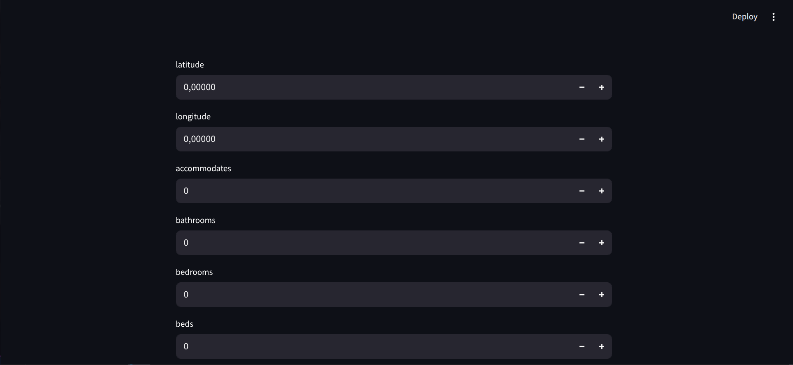
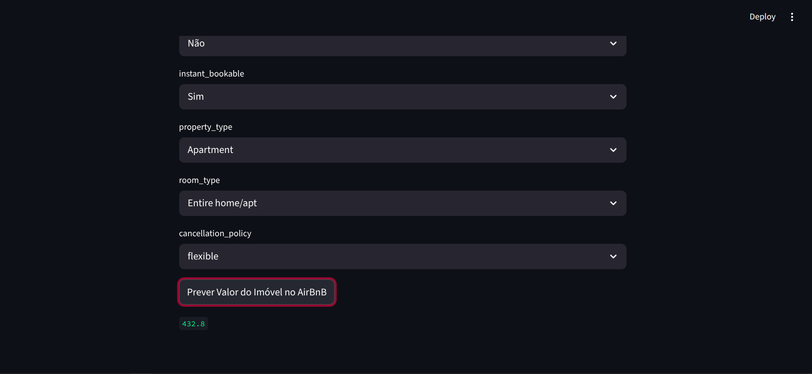

# Ferramenta de Previsão de Preços Airbnb

Ferramenta de previsão de preços de imóveis do Airbnb, na cidade do Rio de Janeiro, após análise exploratória de dados e criação de um modelo joblib.

---

## Demonstração

| Página Inicial | Previsão de Preços |
| :---: | :---: |
|  |  |

---

## Tecnologias

Este projeto foi desenvolvido utilizando as seguintes tecnologias:

- **Python 3.12.3**
- **Pandas e Polars (Análise e manipulação de grandes volumes de dados)**
- **Matplotlib e Seaborn (Criação de gráficos)**
- **Joblib (Criação de modelo de previsão)**
- **Streamlit (Criação de interface para utilização da ferramenta)**

---

## Funcionalidades

- [x] Previsão de preços de imóveis do Airbnb na cidade do Rio de Janeiro
- [x] Interface do Streamlit para que o usuário possa preencher as informações e fazer previsões

---

## Estrutura de Dados

O projeto utiliza uma base de dados muito grande, portanto não consigo subir no GitHub. Segue o link para download da base de dados utilizada na análise, feita no notebook:

https://www.kaggle.com/datasets/allanbruno/airbnb-rio-de-janeiro

---

## Como Executar o Projeto

### Pré-requisitos

Antes de começar, você precisará ter instalado em sua máquina:
- [Git](https://git-scm.com)
- [Python 3.12](https://www.python.org/)

### Passo a Passo

1. **Clone este repositório:**
   ```bash
   git clone https://github.com/Brazil25/ferramenta_de_previsao_precos_airbnb
   ```

2. **Acesse o link e baixe a base de dados:**
   - Baixe a base de dados do Kaggle para poder realizar a análise de dados e criação e treinamento do modelo joblib.

3. **Acesse a pasta do projeto:**
   ```bash
   cd ferramenta_de_previsao_precos_airbnb
   ```

4. **Crie e ative o ambiente virtual (opcional, mas recomendado):**
   ```bash
   python -m venv .venv
   source venv/bin/activate  # Linux/Mac
   # ou: venv\Scripts\activate  # Windows
   ```

5. **Instale as dependências:**
   ```bash
   pip install -r requirements.txt
   ```

6. **Faça a análise de dados e criação do modelo joblib:**
   - **IMPORTANTE:** o arquivo do modelo (`modelo.joblib`) pesa mais de 5 GB devido ao volume histórico da base de dados do Rio de Janeiro e, por isso, não está incluído no repositório do GitHub. Para rodar a aplicação visual, execute o notebook de treinamento na sua máquina para gerá-lo localmente (utilizando o algoritmo ExtraTrees e as métricas de avaliação descritas no projeto).

7. **Execute a aplicação:**
   ```bash
   streamlit run DeployAirbnb.py
   ```

8. **Acesse o link:**
   - Acesse o link de desenvolvimento gerado pelo Streamlit para ter acesso à ferramenta e todas as suas funcionalidades.

---

## Licença

Este projeto está sob a licença MIT.
